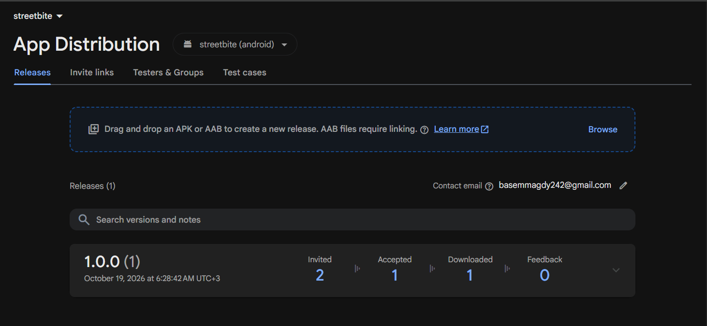
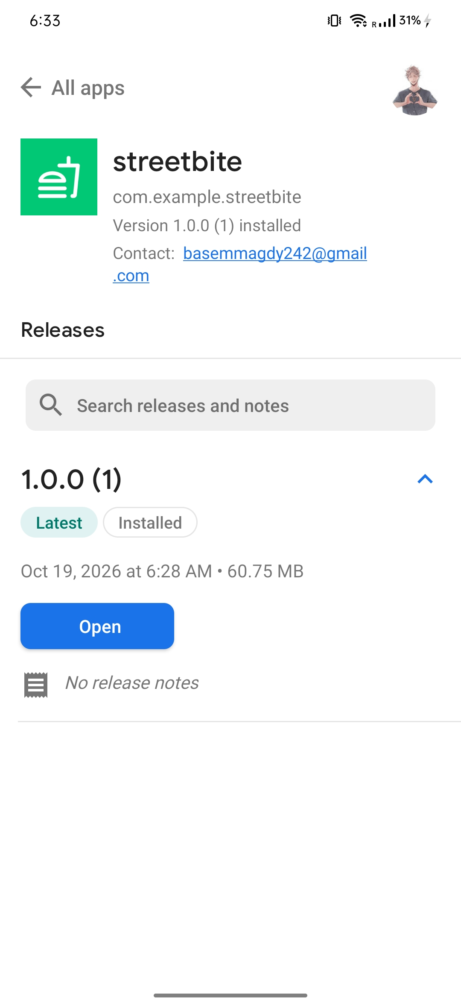

# StreetBite

StreetBite is a Flutter food discovery and ordering demo for Android and iOS. It offers email sign-in, a live meal menu, favourites, a persistent cart, checkout, order history, vendor maps, a protected profile, light/dark themes, and English/Arabic localization with RTL layout.

## What the app does

- **Account and profile:** Firebase Authentication handles email/password credentials. Firestore stores each user's name, email, optional profile photo, favourites, and orders under `Users/{uid}`. The profile also shows device details. Profile access can require device biometrics; the lock preference persists locally. Photos are picked through the platform picker and stored as compressed base64 in the user document.
- **Discover:** TheMealDB API supplies the menu. A local cache appears while the app refreshes and remains visible when the network fails. Featured meals, offers, and cards lead to meal details. Six sample vendors across Egyptian cities appear on a Google Map; they are demonstration data, not live vendor locations.
- **Order:** The cart groups identical meals, saves locally for each signed-in user, and adds fixed $3.99 delivery and $2.45 fees/taxes at checkout. TheMealDB does not provide prices, so the app derives stable demo prices and ratings from meal IDs. Checkout can show the device location. Orders are saved to `Users/{uid}.orders` and streamed in the Orders tab; legacy `Users/{uid}/Orders` entries are still read.
- **Payment:** Cash orders are `dueOnDelivery`. Card is only a selectable option: no card information is collected and no charge occurs. Card orders stay `pending` until a payment gateway is added.
- **Language and appearance:** English and Arabic strings are in ARB files. A language toggle and light/dark toggle save their choices through SharedPreferences.

## Architecture and design patterns

The app follows a layered architecture. `presentation` widgets use BLoC/Cubit state. Domain use cases and repository contracts express app behavior. Data sources and repository implementations connect those contracts to Firebase, TheMealDB, local preferences, and device APIs.

| Pattern | Where | Why |
| --- | --- | --- |
| Repository | `lib/domain/repositories/`, `lib/data/repositories/` | Keeps UI and use cases independent of persistence and network APIs. |
| Dependency injection | `lib/injection.dart` | Registers shared services and injects contracts into use cases and state classes; tests can supply fakes. |
| BLoC/Cubit | `lib/presentation/blocs/` | Separates events/state and asynchronous work from widgets. Cart events are serialized to avoid restore/edit races. |
| Strategy | `PaymentMethod` with cash/card implementations | Checkout chooses a payment behavior by type while each method defines its result status. |
| Facade | `FirestoreService` | Centralizes user document access and merge writes for profile data. |

## File structure

```text
streetbite/
├── lib/
│   ├── main.dart
│   ├── app.dart
│   ├── injection.dart
│   ├── core/
│   │   ├── constants/
│   │   ├── errors/
│   │   ├── formatting/
│   │   ├── theme/
│   │   └── validation/
│   ├── data/
│   │   ├── datasources/
│   │   ├── models/
│   │   └── repositories/
│   ├── domain/
│   │   ├── entities/
│   │   ├── repositories/
│   │   └── usecases/
│   ├── presentation/
│   │   ├── blocs/
│   │   ├── l10n/
│   │   ├── screens/
│   │   └── widgets/
│   └── l10n/
│       ├── app_en.arb
│       ├── app_ar.arb
│       └── app_localizations*.dart
├── test/
│   ├── automation/
│   ├── helpers/
│   └── *_test.dart
├── android/
├── ios/
├── assets/
├── screenshots/           # app and Firebase App Distribution evidence
├── firestore.rules
├── pubspec.yaml
└── README.md
```

## Setup and run

1. Install the Flutter SDK compatible with Dart `^3.13.5`, then run `flutter pub get` from this directory.
2. Enable **Email/Password** in Firebase Authentication and create a Cloud Firestore database. The repository includes `lib/firebase_options.dart` and Android Firebase configuration for the existing project. For a different Firebase project, run `flutterfire configure` and replace its generated configuration.
3. Deploy the included rules before sign-up or orders testing: `firebase deploy --only firestore:rules --project streetbite-324a0`. Use your own project ID if you changed projects. Rules restrict each user to their own `Users/{uid}` document and legacy orders subcollection.
4. Configure Google Maps: enable the Maps SDKs for Android and iOS and billing in Google Cloud. Put `MAPS_API_KEY=your-key` in ignored `android/local.properties` and `ios/Flutter/Maps.xcconfig`. Restrict production keys to your app IDs and signing certificates. The iOS map uses SDK 9 for the iOS 15 target.
5. Run `flutter run` on an Android or iOS device/emulator. The committed Firebase options target these platforms.

The menu uses TheMealDB development API key `1`. Firebase and maps need their services and network access; widget tests use fakes and run offline.

## Permissions and device access

| Platform | Declaration | Used for |
| --- | --- | --- |
| Android | `INTERNET` | Firebase, meal API, and map requests. |
| Android | `ACCESS_COARSE_LOCATION`, `ACCESS_FINE_LOCATION` | Foreground location on the checkout map. |
| Android | `USE_BIOMETRIC` | Optional profile lock. |
| iOS | `NSLocationWhenInUseUsageDescription` | Foreground location on the checkout map. |
| iOS | `NSFaceIDUsageDescription` | Optional Face ID profile lock. |
| iOS | `NSPhotoLibraryUsageDescription` | Selecting a profile photo. |

Location is requested at runtime; checkout falls back to the last known position and remains usable if location is unavailable. Android's system photo/document pickers grant access to the selected file, so broad media storage permission is unnecessary. `device_info_plus` needs no runtime permission. Device biometrics must be enrolled for the lock to open the profile; an Android emulator can simulate a scan with `adb emu finger touch 1`.

## Localization and assets

Edit `lib/l10n/app_en.arb` and `app_ar.arb`, then run `flutter gen-l10n`. Generated `AppLocalizations` files are committed. Screens translate language-neutral `AppMessage` values at render time. Arabic supports RTL layout; translations should receive a native-speaker review before release.

`assets/images/logo.svg` is the source for `assets/images/splash_logo.png`; after changing it, run `dart run flutter_native_splash:create`. Launcher icon sources are `assets/icon/app_icon.png` and `assets/icon/app_icon_foreground.png`; regenerate native icons with `dart run flutter_launcher_icons`.

## Firebase App Distribution

The Android beta shown below is **version 1.0.0 (build 1)** for `com.example.streetbite` in Firebase project `streetbite-324a0`.

1. From `streetbite/`, run `flutter build apk --release`. The output is `build/app/outputs/flutter-apk/app-release.apk`.
2. Open **Firebase console → streetbite → App Distribution**, select the **streetbite (android)** app, and upload the APK on the **Releases** tab.
3. Add at least two tester email addresses to the release, optionally add release notes, then finish distributing the release.
4. Testers accept the invitation and download the APK through Firebase App Distribution. Check the release dashboard for invitation, acceptance, and download counts.

The screenshots document the completed beta workflow: the upload began, two testers were added, and the release was distributed. The later Firebase dashboard shows **2 invited, 1 accepted, and 1 downloaded**. A tester's App Distribution screen shows version `1.0.0 (1)` installed. These counts capture the state shown in the screenshots; they do not establish that both invitees installed the app.

| Evidence | Screenshot |
| --- | --- |
| APK upload in Firebase | [Upload progress](screenshots/uploading_release_apk.png) |
| Two testers added to release `1.0.0 (1)` | [Adding testers](screenshots/adding_testers.png) |
| Distribution step | [Distributing the app](screenshots/distrubuting_app.png) |
| Release dashboard with invitation, acceptance, and download counts | [Firebase release dashboard](screenshots/invitation_acceped_by_tester.png) |
| Tester download screen | [Download available](screenshots/tester_downloading_app.jpg) |
| Tester installation | [App installed and ready](screenshots/app_ready_for_tester.jpg) |

Firebase release dashboard after distribution:



Tester device with StreetBite installed:



The current Android release build is signed with the Android debug certificate configured in `android/app/build.gradle.kts`. Keep the same signing certificate for updates to this beta install, or configure a dedicated release key before starting a long-term distribution track.

## Checks

Run `dart format .`, `flutter analyze`, and `flutter test` from this directory. Tests are organized by feature and use `BaseTest` and feature helpers in `test/automation/` for shared widget setup and feature actions.

## QA and Appium

The [QA workspace](qa/README.md) contains the manual test plan, 32 test cases, execution log, traceability matrix, closure summary, and Java Appium project. Appium covers the requested Login and Home flows; its setup and run commands are in `qa/README.md`. Physical-device results and Jira defects are recorded only after execution.
